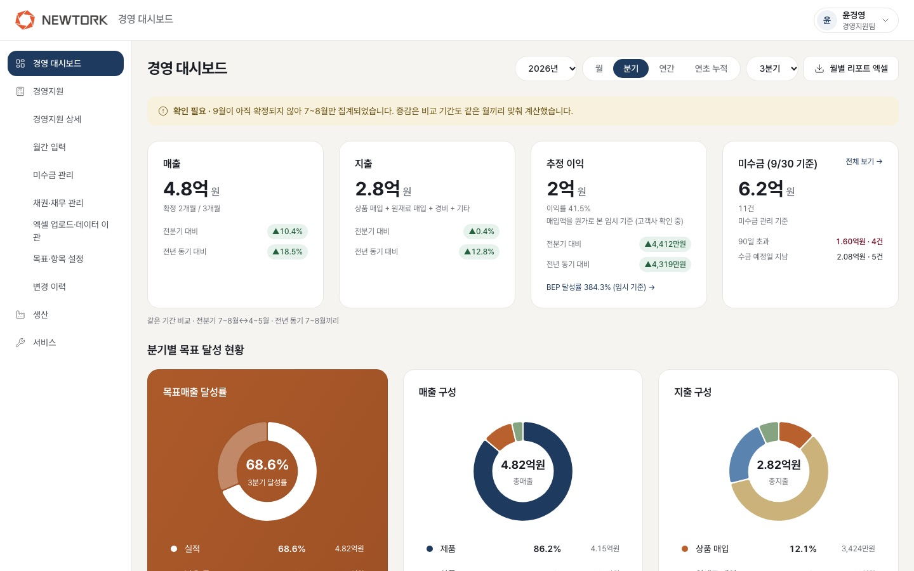
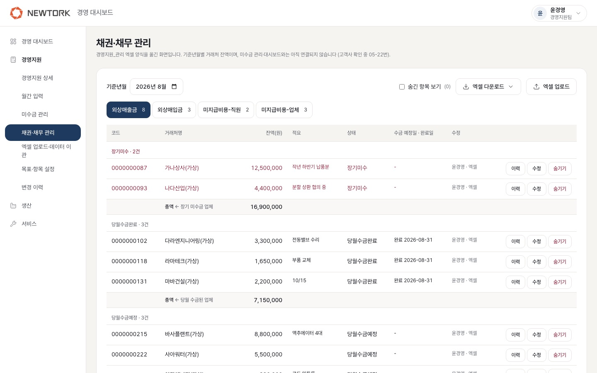

# 결과 보고서 — 뉴토크코리아 경영 대시보드 (경영지원팀 PoC)

2026년 10월 26일 · 경영지원팀 담당 개발

> 범위: 메인 화면(경영 대시보드) + 경영지원팀 화면 + 로그인·관리자. 생산팀·서비스팀 화면은 각 팀이 따로 개발한다.
> 화면 사진은 모두 연습용 가짜 데이터다. 사진은 2026-10-25 화면이라 일부 메뉴 이름이 예전 단어로 보인다.

---

## 1. 한줄 요약

대표자가 현장에 없어도 **월간 입력과 「경영지원 관리」 엑셀**만으로 전사 **원가·이익률·자금 수지·손익분기점(BEP) 달성률·인당 생산성**과 **연간·분기 목표 달성률**을 한 화면에서 보고, 같은 숫자를 **월별 리포트** 엑셀로 받는 경영 대시보드 웹앱(PoC)을 만들어 시험 서버에 올렸다. 가동률은 생산팀 자료가 필요해 이 범위에 넣지 않았다.

## 2. 추진 배경 (기획서 → 이번에 다룬 것)

| 기획서의 문제 | 이번 PoC 에서 한 것 |
|---|---|
| 데이터에 근거한 체계적 경영 및 연간 목표 수립 필요 | 연간·분기 목표매출액 입력, 월 목표(분기 ÷ 3) 자동 계산, 목표매출 달성률·연간 진도를 화면과 엑셀에 표시 |
| 경영에 필요한 핵심 백업 데이터가 분산 | 매출·매입·경비·그 외 지출(월간 입력)과 「경영지원 관리」 엑셀(외상매출금·외상매입금·미지급비용)을 한 DB 로 모음. 과거 엑셀은 원본 양식 그대로 업로드 |
| 대표자가 한눈에 종합적으로 파악하고 즉각적인 의사결정을 내릴 수 있는 통합 모니터링 툴 부재 | 경영 대시보드(첫 화면) 한 장에 매출·지출·추정 이익·미수금, 목표 달성 현황, 추이, AI 분석 자리를 담당자님 요청 순서대로 배치 |

## 3. 개발 목표 (PoC) 와 결과

| 기획서 목표 | 결과 |
|---|---|
| 월별 각 부서에서 간단한 정보를 입력하면 | 경영지원팀: 월간 입력 화면(매출 3·매입 2·경비 1칸 + 그 외 지출 항목 + 월말 통장 잔액(선택)), [경영지원 관리에서 불러오기]로 다시 치지 않고 채우기. 생산·서비스팀은 각 팀 개발 |
| AI 가 분산된 데이터를 취합하고 | 데이터 취합·계산은 **정해진 규칙(적용 기준)으로 서버가 자동 계산**한다. AI 는 계산이 아니라 **분기 분석 코멘트**를 쓴다 — 회사 숫자를 외부 AI 로 보내는 일이라 **대표님 허락 전까지 꺼둠** |
| 정해진 기준에 따라 원가, 이익률, 가동률 등을 자동 산출 | 원가(매입액 = 원가)·이익률·추정 이익·손익분기점(BEP) 달성률·인당 생산성·미수금·자금 수지 예측: **자동 산출 완료**. 가동률: **범위 밖**(생산팀) |

## 4. 주요 기능 구현 결과

### 4-1. 기획서 항목별

| 구분 | 기획서 항목 | 상태 | 어디서 |
|---|---|---|---|
| 직원 | 계정 인증 | 완료 | 로그인·비밀번호 변경·5회 실패 잠금·관리자 초기화 |
| 직원 | 실적 작성(팀별) | 완료 (경영지원팀) / 범위 밖 (생산·서비스팀) | 월간 입력 |
| 직원 | 임시저장·수정·파일 업로드 | 완료 | 임시저장·확정·확정 후 수정·확정 취소, 엑셀 업로드 2종 |
| 직원 | 입력방법 안내 표시 | 완료 | 칸마다 ⓘ 안내, 사용 안내서 |
| 관리자 | 누적 대시보드 | 완료 | 월 / 분기 / 연간 / 연초 누적 |
| 관리자 | 월별 리포트 | 완료 | [월별 리포트 엑셀] |
| 관리자 | 종합 원가/이익률 분석 | 완료 | 이익 계산 표·이익 구조 |
| 관리자 | 프로젝트 원가/이익률 분석 | **보류** (자료 부족) | 사업(수주번호)별 매출·원가 자료 없음 |
| 관리자 | 매입·매출·미수 현황 | 완료 | 대시보드·경영지원 상세·경영지원 관리 |
| 관리자 | 3~6개월 자금 수지 예측 | 완료 | 경영지원 상세 맨 아래 |
| 관리자 | 손익분기점(BEP) 달성률 | 완료 | 경영지원 상세 |
| 관리자 | 생산량 & 공장 가동률 산출 | 범위 밖 (생산팀) | — |
| 관리자 | 수주 잔고 & 영업 파이프라인 | **보류** (자료 부족) | 수주·영업 기회 목록 없음 |
| 관리자 | 인당 생산성 지표 | 완료 | 경영지원 상세 (BEP 옆) |
| 관리자 | 엑셀(CSV) 다운로드 | 완료 (엑셀 6종) | CSV 파일은 만들지 않음 (엑셀로 충분, 05-39) |

전체 요구 항목 100개 대조(처음 문서 3개·기획서·담당자님 추가 요청): **완료 74 / 보류 2 / 범위 밖 24** — `docs/requirements-traceability.md`

### 4-2. 화면

**경영 대시보드** — 매출·지출·추정 이익·미수금 → 분기별 목표 달성 현황 → 추이 및 분석 → AI 분석 (담당자님 요청 순서)

**경영지원 관리** — 쓰시던 「경영지원 관리」 엑셀을 그대로 옮긴 화면

그 밖의 화면(손익분기점·인당 생산성, 자금 수지 예측, 경영지원 관리에서 불러오기)은 시험 서버에서 확인할 수 있다. 새 스크린샷은 따로 찍어 붙인다.

### 4-3. 기획서 밖에서 함께 만든 것

| 기능 | 이유 |
|---|---|
| 변경 이력 (누가 언제 무엇을 바꿨는지, 엑셀을 누가 받았는지) | 경영지원팀 전원이 수정할 수 있게 정한 대신 기록을 남김. 기록은 고치거나 지울 수 없음 |
| 관리자 설정 (권한·계정·비밀번호 초기화) | 10/14 미팅 "관리자 페이지에서 권한 등록/해제" |
| 미수금 건별 기록 | 거래 한 건씩 메모하는 참고용 화면 (대시보드는 외상매출금 기준) |
| 원본과 같은 모양의 엑셀 6종 | 쓰시던 엑셀과 같은 글꼴·색·표 배치, 다시 올리기 가능 |

## 5. 활용 데이터

| 데이터 | 넣는 방법 | 쓰는 곳 |
|---|---|---|
| 월간 실적 (제품·상품·용역 매출, 상품·원재료 매입, 경비, 그 외 지출) | 월간 입력 / 엑셀 업로드 / [경영지원 관리에서 불러오기] | 대시보드·상세·리포트 (확정한 달만), 자금 수지 추정 |
| 「경영지원 관리」 (외상매출금·외상매입금·미지급비용-직원·업체) | 화면 입력 / 원본 엑셀 업로드 / [지난달 내용 불러오기] | 미수금, 자금 수지 예정, 월간 입력 불러오기 |
| 연간·분기 목표매출액, 직원 수 | 목표·항목 설정 | 목표 달성률, 인당 생산성 |
| 월말 통장 잔액 (선택) | 월간 입력 | 자금 수지 예상 잔액 |
| 산업 분야별·제품 시리즈별 판매 | **생산팀 연동 전 — 목업**(샘플) | 대시보드 원형 그래프 2개 ("샘플 데이터" 표시) |
| 그룹웨어 연동자료 | **연동하지 않음** (통합 단계) | — |

시험 서버와 이 보고서의 숫자는 모두 **연습용 가짜 데이터**(2024-10 ~ 2026-10)다. 실제 회사 숫자는 아직 넣지 않았다.

## 6. 기대효과 대비 결과

측정하지 않은 숫자는 결과로 쓰지 않았다.

| 기대 효과 (기획서) | 실제 확인한 것 (테스트·화면 확인) | 운영 후 측정 필요 |
|---|---|---|
| (정량) 자료 취합·정리 월 약 8시간 × 부서 수 → 1시간 미만 | 월말 입력 경로가 월간 입력 화면 하나로 모였고, 경영지원 관리에 넣은 숫자를 [불러오기]로 다시 치지 않고 채울 수 있음을 화면으로 확인. 월별 리포트는 버튼 한 번으로 생성 | **실제 걸리는 시간** — 담당자님이 한두 달 써 본 뒤 월말 입력·리포트 작성 시간을 재야 함. 다른 부서는 각 팀 화면이 붙은 뒤 |
| (정량) 수기 작성 오류 제거 | 입력 검증(숫자만·15자리·자릿수 10배 경고·0원 확정 확인), 엑셀 업로드는 오류가 하나라도 있으면 저장 안 함, 원본 총액 비교, 동시 수정 방지, 계산은 원 단위 정수(BigInt) — 자동 테스트 776개로 고정 | 실제 오류가 줄었는지(전월 대비 수정 건수 등) — 변경 이력으로 셀 수 있음 |
| (정성) 데이터 경영 체계 확립 | 계산 기준을 "적용 기준" 5줄로 화면·리포트에 명시, 확정한 달만 집계, 변경 이력 | 대표님·담당자님 실제 사용 후 판단 |
| (정성) 분기별 OKR 추진 가능 | 분기 목표·분기 달성률·연간 진도·월 목표(분기 ÷ 3)와 끝난 분기 미달 표시까지 구현. **OKR(목표·핵심 결과) 자체를 적고 관리하는 화면은 없음** | 분기 목표 관리로 충분한지, OKR 화면이 필요한지 운영 후 결정 |
| (정성) 근거 기반 연간 목표 수립 | 과거 실적 엑셀 이관, 월별 추이 12개월, 목표 대비 실적 엑셀 | 다음 해 목표를 이 자료로 세웠는지 |

검증한 것 (2026-10-26 기준)
- 자동 테스트 776개 통과, CI(GitHub Actions)로 PR 마다 검사
- 실제 DB 점검(`db:smoke`) — 모든 표·칸과 화면이 쓰는 조회
- 엑셀 6종을 원본 「경영지원 관리」와 칸 단위로 비교 — 의도하지 않은 차이 0건, 엑셀 합계 = 대시보드 숫자
- 자금 수지 예측 숫자 직접 검산 (11월 수금 예정 370,500,000원, 추정 평균은 SQL 계산과 같음)
- 시험 서버(Render) 배포 성공, 담당자 확인용 체크리스트로 화면 확인

## 7. 개발 과정

### 7-1. 시스템 구성

| 영역 | 선택 |
|---|---|
| 웹 | Next.js 16 (App Router) + TypeScript, Tailwind |
| DB | PostgreSQL 16 + Prisma 7 (금액은 BigInt 정수, 월 단위로만 저장하고 분기·연간은 조회할 때 계산) |
| 로그인 | 외부 서비스 없이 자체 구현 (비밀번호 scrypt 해시, DB 세션 12시간) |
| 엑셀 | exceljs — 원본 양식 파일의 서식을 읽어 같은 모양으로 그림 |
| AI | Anthropic API (서버에서만 호출, 지금은 실제 숫자 꺼둠) |
| 시험 서버 | Render 무료 플랜 (웹 + PostgreSQL, 싱가포르), main 에 합치면 자동 배포 |

팀별 저장소를 나중에 합치는 구조라, 경영지원 코드는 `modules/management`·`mgmt_*` 표 안에만 두고 다른 팀 데이터는 정해 둔 함수 형식(목업)으로만 가져온다 (`docs/integration-notes.md`).

### 7-2. 데이터 수집·입력

- 월간 입력: 임시저장 → 확정(팀장·경영지원팀), 이번 달은 임시저장만, 전월 값 비교, 브라우저 임시 보관
- 「경영지원 관리」: 엑셀과 같은 항목·묶음, 원본 엑셀 1회 이관(블록 제목·병합·빨간 글씨·연두 배경으로 판별), [지난달 내용 불러오기]
- 월간 입력 ↔ 경영지원 관리 연결: [경영지원 관리에서 불러오기] — 미리보기·묶음별 ÷1.1 환산 체크, 저장은 사람이
- 목표·항목·직원 수 설정, 미수금 건별 기록(참고용)

### 7-3. 통합 분석·지표 산출

- 계산은 DB·화면과 분리한 순수 함수(`metrics/`)로 만들고 테스트로 고정: 기간 집계(확정한 달만), 증감(같은 달끼리 비교), 목표 달성률, 이익·이익률, BEP(공헌이익 ÷ 고정비), 인당 생산성, 미수금(외상매출금 기준월), 자금 수지 예측
- 고객사 질문 46개를 받은 자료로 결정하고 화면에 "**적용 기준**"으로 남김 (`docs/05-open-questions.md`)
- AI 분석: 서버가 계산한 숫자 문장만 보내고(거래처명 제외), AI 는 요약·부족한 점·개선점을 씀. 응답 형식 검증

### 7-4. 대시보드·리포트

- 경영 대시보드: 담당자님 요청 구성(KPI 4 → 분기별 목표 달성 현황 → 추이 및 분석 → AI 분석), 비중은 원형(도넛) 그래프
- 경영지원 상세: 표·원 단위 금액, 이익 구조, BEP, 인당 생산성, 미수금, 자금 수지 예측
- 엑셀 6종: 경영지원 관리, 월간 입력, 목표 대비 실적, 미수금 건별 기록, **월별 리포트**, 변경 이력 — 원본과 같은 모양, A4 인쇄
- 화면 단어는 담당자님 자료 단어(경영지원 관리, 장기 미수금, 당월 수금, 당월 수금예정, 미수금 건별 기록, 자금 수지 예측)

## 8. 남은 과제

| 구분 | 과제 | 필요한 것 / 담당 |
|---|---|---|
| 자료 부족 보류 | 프로젝트 원가/이익률 분석 | 사업(수주번호)별 매출·원가 자료와 배분 기준 |
| 자료 부족 보류 | 수주 잔고 & 영업 파이프라인 | 수주 목록(금액·납기·출고), 영업 기회 목록 |
| 범위 밖 | 생산량 & 공장 가동률, 산업 분야별·제품 시리즈별 실제 데이터 | 생산팀 — 통합 때 정해 둔 함수로 연결 (`docs/interface-production.md`) |
| 범위 밖 | 서비스팀 지표 (출장·부품·지도) | 서비스팀 |
| 범위 밖 | 그룹웨어(다우오피스) 연동 | 대표님(IT)·통합 단계 |
| 대표님 허락 필요 | AI 분석에 실제 숫자 사용 | 허락 후 설정 하나(`AI_ALLOW_REAL_DATA=true`)로 켬 — 시험 서버 차단과 엑셀 업로드로 옮긴 달 차단이 함께 풀림. 보내는 것은 합계 숫자뿐(거래처명·직원 이름·건별 내역 제외) |
| 운영 | 운영 서버 위치 (사내 / 클라우드) | IT·대표님 결정 (05-8). 지금은 Render 시험 서버 |
| 운영 | Render 시험 DB 무료 기간 만료 **2026-11-20** (추정) | 만료되면 새로 만들고 시드만 다시 넣음 — `docs/render-db-expiry.md`. 시연이 겹치면 그 달만 유료 |
| 운영 | 실제 데이터 입력 후 효과 측정 | 월말 작업 시간, 수정 건수 (6장) |
| 기술 후속 | BEP 이전 기간 대비 변화, BEP 를 AI 분석에 넣기, 자금 수지 예측을 엑셀·리포트에 넣기 | 필요 시 |
