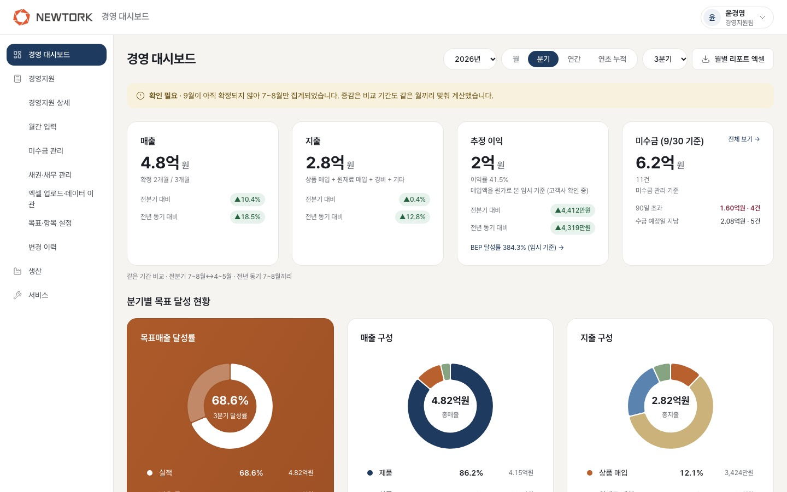
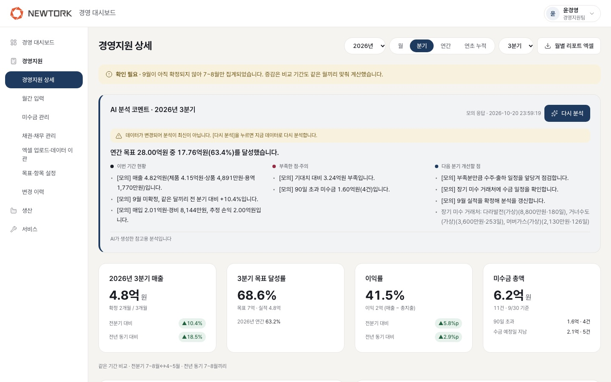
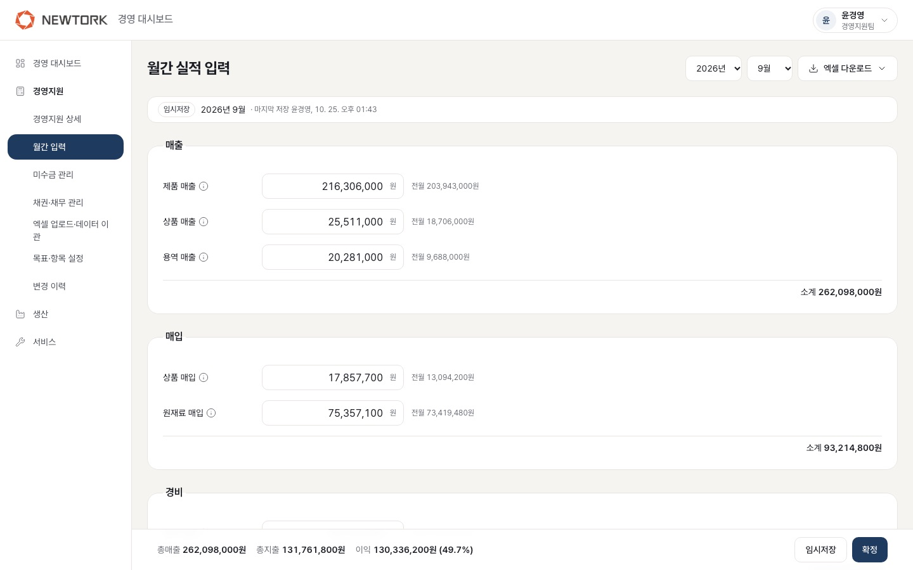
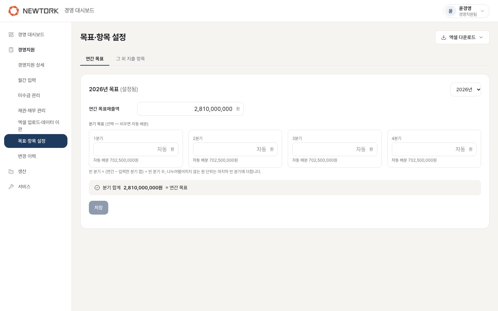
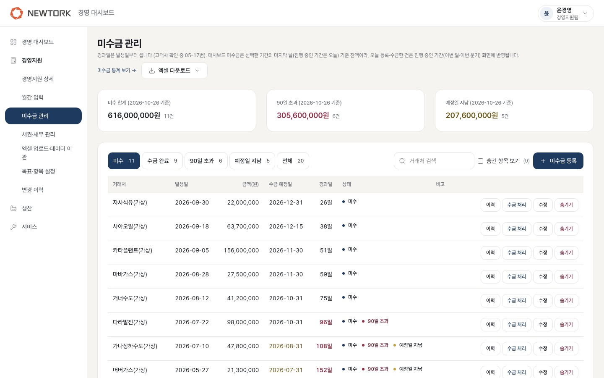
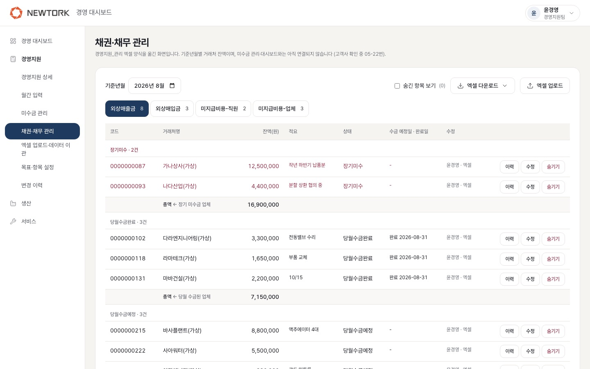
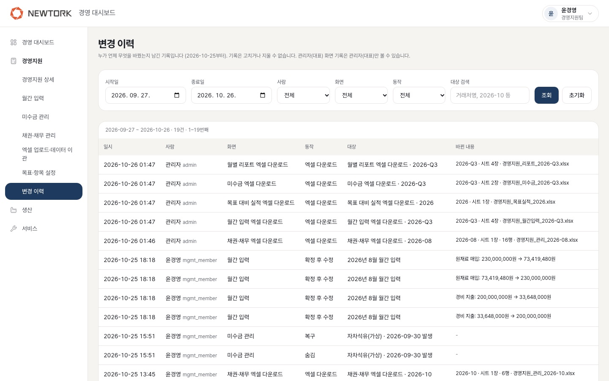
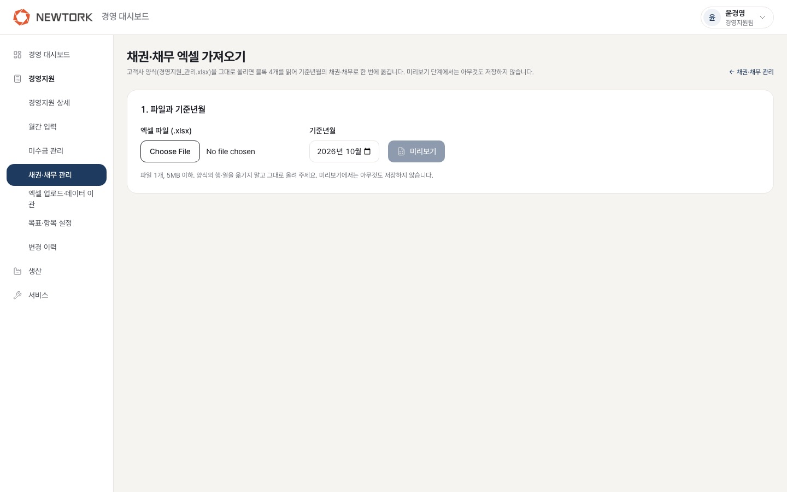
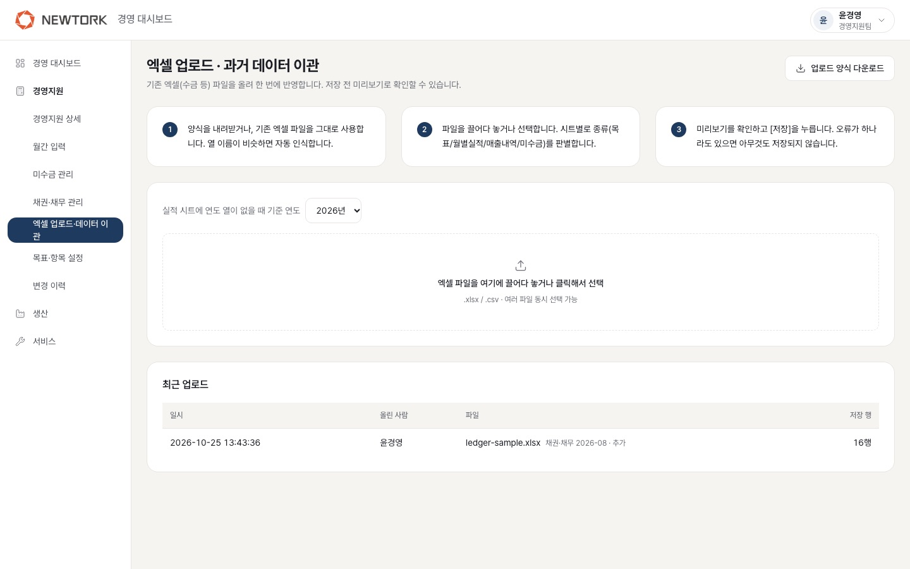

# 경영 대시보드 사용 안내서

뉴토크코리아 경영지원팀 담당자님께 · 2026년 10월 26일

> 이 안내서는 경영 대시보드의 **경영지원 화면**을 처음 쓰시는 분을 위한 설명입니다.
> 화면 사진은 모두 **연습용 가짜 데이터**로 찍었습니다. 실제 숫자와 다릅니다.

---

## 1. 처음 시작하기

### 로그인

- 아이디와 비밀번호는 **관리자(대표님)가 만들어 드립니다.** 직접 가입하는 화면은 없습니다.
- 처음 로그인하면 **비밀번호를 바꾸는 화면**이 먼저 나옵니다. 새 비밀번호를 정해야 다음 화면으로 넘어갑니다.
  - 8자 이상, 영문과 숫자를 함께
  - 아이디와 같거나 지금 비밀번호와 같으면 안 됩니다
- 로그인은 **12시간** 동안 유지됩니다. 시간이 지나면 다시 로그인해 주세요.
- 시험용 주소는 오랫동안 아무도 열지 않으면 잠들어 있어서, **처음 열 때 1분 정도 걸릴 수 있습니다.**

### 비밀번호 바꾸기

- 화면 오른쪽 위 **이름**을 누르고 **[비밀번호 변경]**을 고릅니다.

### 비밀번호를 5번 틀리면

- 같은 아이디로 **5번 연속 틀리면 10분 동안 잠깁니다.** 10분 뒤에 다시 시도해 주세요.
- 비밀번호가 생각나지 않으면 **관리자(대표님)께 [비밀번호 초기화]를 부탁**해 주세요. 받은 임시 비밀번호로 로그인하면 새 비밀번호를 정하는 화면이 나옵니다.

### 메뉴

- 왼쪽에 메뉴가 있습니다. **경영지원** 아래에 이 안내서에서 설명하는 화면들이 모여 있습니다.
- 사람마다 볼 수 있는 메뉴가 다릅니다. 보이지 않는 메뉴는 권한이 없는 화면입니다.

---

## 2. 경영 대시보드 (첫 화면)

### 기간 바꾸기

- 오른쪽 위에서 **연도 → 보는 단위(월 / 분기 / 연간 / 연초 누적) → 월이나 분기**를 고릅니다.
- 처음 열면 **가장 최근에 끝난 분기**가 보입니다.
- 노란 줄 **"확인 필요"**는 기간 안에 아직 확정하지 않은 달이 있다는 뜻입니다. 그 달은 합계에서 빠져 있습니다.

### 화면 보는 법 (위에서 아래로)

| 영역 | 내용 |
|---|---|
| **맨 위 네 칸** | **매출 / 지출 / 추정 이익 / 미수금**. 작은 ▲▼ 표시는 지난 기간·작년 같은 기간과 비교한 것입니다. 추정 이익은 금액 차이로 보여 드립니다. 미수금 칸의 [전체 보기]를 누르면 자세한 표로 갑니다 |
| **분기별 목표 달성 현황** | **목표매출 달성률**(주황색 카드), **매출 구성**(제품·상품·용역), **지출 구성**(상품 매입·원재료 매입·경비·기타). 지출 구성의 [항목별 보기]를 누르면 기타(광고선전비·접대비 등)의 항목별 금액이 나옵니다 |
| **추이 및 분석** | 최근 12개월 **매출·지출 막대**와 **이익률 선**, **산업 분야별 매출**, **제품별 매출**(제품 시리즈 기준). 산업 분야별·제품별은 생산팀 자료를 연결하기 전이라 **"샘플 데이터"**로 표시됩니다 |
| **AI 분석** | 이번 분기 요약과 다음 분기에 개선할 점. 대표님 확인 전이라 **예시 숫자로만** 동작합니다 |

### 원형 그래프 공통

- 그래프나 목록에 마우스를 올리면 그 항목의 비율이 가운데에 크게 나옵니다.
- 카드 아래 **[표로 보기]**를 켜면 숫자 표로 바뀌고, **[내보내기]**로 그 카드 숫자를 파일로 받을 수 있습니다.

### 월별 리포트 엑셀

- 기간 선택 옆 **[월별 리포트 엑셀]**을 누르면 **지금 보고 있는 기간**의 리포트를 엑셀로 받습니다. (9장 참고)

---

## 3. 경영지원 상세

- 메뉴 **경영지원 → 경영지원 상세**. 첫 화면과 같은 기간을 **표와 원 단위 금액**으로 자세히 봅니다.
- 매출 구성, 지출 항목, 이익 계산, 분기별 목표, 손익분기점(BEP) 계산 내역, 미수금(거래처별·경과일 구간·수금 예정)이 있습니다.
- 첫 화면에서 빠진 그래프 네 개(**연간 목표 달성률, 손익분기점, 이익 구조, 미수금 원형**)는 이 화면의 관련 표 옆에 있습니다.

---

## 4. 월간 입력

- 메뉴 **경영지원 → 월간 입력**. 오른쪽 위에서 연도와 월을 고르고, 매출·매입·경비·그 외 지출 금액을 원 단위로 넣습니다.
- 숫자만 치면 천 단위 콤마가 자동으로 붙습니다. 칸 옆에 **지난달 금액**이 보이고, 자릿수를 잘못 넣은 것 같으면(예: 10배) 알려 드립니다.
- 저장하지 않고 다른 화면으로 가려고 하면 한 번 더 물어봅니다.

### 임시저장과 확정

| | 임시저장 | 확정 |
|---|---|---|
| 언제 | 아직 숫자가 다 정해지지 않았을 때 | 그 달 숫자를 다 넣고 맞는지 확인했을 때 |
| 대시보드 | **합계에 들어가지 않습니다** | **합계에 들어갑니다** |
| 빈 칸 | 0원으로 저장됩니다 | 0원인 항목이 있으면 한 번 더 확인합니다 |
| 나중에 고치기 | 언제든 다시 저장 | 숫자를 고치고 [수정 저장], 또는 [확정 취소] (변경 이력에 남습니다) |

- "그 외 지출" 항목(광고선전비·접대비 등)을 늘리거나 이름을 바꾸려면 **목표·항목 설정**에서 합니다.
- 오른쪽 위 **[엑셀 다운로드 ▾]**로 그 달(또는 분기·연간·연초 누적)의 입력 내용을 받을 수 있습니다.

### 경영지원 관리에서 불러오기

경영지원 관리에 그 달 외상매입금·미지급비용을 먼저 넣으셨다면, 같은 숫자를 다시 치지 않고 불러올 수 있습니다.

1. 오른쪽 위 **[경영지원 관리에서 불러오기]**를 누르면 미리보기가 뜹니다.
2. 묶음마다 어느 칸에 얼마가 들어가는지(지금 값 → 채울 값) 보여 드립니다.

| 경영지원 관리 | 들어가는 칸 | ÷1.1 환산 (기본) |
|---|---|---|
| 외상매입금 | 상품 매입 / 원재료 매입 (매입유형대로) | 체크 |
| 미지급비용-직원 | 경비 지출 | 해제 |
| 미지급비용-업체 | 그 외 지출 (광고선전비·접대비 → 같은 이름 항목, 기타 → 고른 항목) | 체크 |

- 경영지원 관리 금액은 **부가세 포함**, 월간 입력은 **공급가액**이라 체크한 묶음은 ÷1.1로 바꿔서 채웁니다. 묶음마다 체크를 바꿀 수 있습니다.
- 미지급비용-업체는 **자동이체를 포함한 전체 합계**를 불러옵니다(그 달에 실제로 나간 돈). 엑셀 F열 총액(자동이체 제외)과 다르므로 미리보기에 둘 다 보여 드립니다.
- 매입유형이 빈 외상매입금, 넣을 항목이 없는 업체 지출은 채우지 않고 알려 드립니다. 넣을 칸을 고르면 채웁니다.
- **[입력란에 채우기]는 저장하지 않습니다.** 숫자를 확인한 뒤 [임시저장] 또는 [확정]을 누르세요. 매출 칸은 바뀌지 않습니다.

---

## 5. 목표·항목 설정

- 메뉴 **경영지원 → 목표·항목 설정**.
- **연간 목표** 탭: 그 해의 **연간 목표매출액**을 넣습니다.
  - 분기 목표는 **넣지 않아도 됩니다.** 비워 두면 남은 금액을 빈 분기 수로 똑같이 나눠 채웁니다.
  - 분기 목표 4개를 모두 넣었는데 합계가 연간 목표와 다르면 알려 드립니다.
  - **월 목표는 분기 목표를 3으로 나눈 값**으로 자동 계산됩니다. 대시보드를 "월"로 볼 때 이 월 목표 대비 달성률이 나옵니다.
- **그 외 지출 항목** 탭: 항목 추가, 이름 바꾸기, 순서 바꾸기, 고정비·변동비 구분, 사용 안 함. 한 번도 금액을 넣은 적 없는 항목만 지울 수 있습니다.
- 오른쪽 위 **[엑셀 다운로드 ▾]**로 그 해의 **목표 대비 실적**을 받습니다.

---

## 6. 미수금 건별 기록

- 메뉴 **경영지원 → 미수금 건별 기록**. 받을 돈을 **거래 한 건씩** 관리합니다.
- 위의 세 칸: **미수 합계 / 90일 초과 / 예정일 지남**.
- 아래 탭(미수 · 수금 완료 · 90일 초과 · 예정일 지남 · 전체)과 거래처 검색으로 골라 봅니다.

| 하고 싶은 일 | 방법 |
|---|---|
| 새로 등록 | **[미수금 등록]** → 거래처, 발생일, 금액, 수금 예정일, 비고. 발생일은 오늘 이후로 넣을 수 없습니다 |
| 돈을 받았을 때 | 그 줄의 **[수금 처리]** → 수금일 입력 |
| 고치기 | **[수정]**. 이미 수금 완료한 건을 고치거나 수금을 취소하는 것은 확정 권한이 있는 분만 할 수 있습니다 |
| 지우고 싶을 때 | **[숨기기]**. 지우지 않고 숨깁니다. 숨긴 건은 대시보드·통계에서 빠집니다. **[숨긴 항목 보기]**를 켜고 **[복구]**하면 되돌아옵니다 |
| 누가 바꿨는지 보기 | 그 줄의 **[이력]** |

- 경과일은 **발생일부터** 셉니다. (기준은 확인 중입니다)
- 오른쪽 위 **[엑셀 다운로드 ▾]**: 이번 달(오늘 기준) / 지난달 말 / 지난 분기 말 기준으로 받습니다.

---

## 7. 경영지원 관리

- 메뉴 **경영지원 → 경영지원 관리**. 쓰시던 엑셀 **「경영지원 관리」를 그대로 옮긴 화면**입니다. 항목 이름과 순서도 엑셀과 같습니다.
- 위에서 **기준년월**을 고르고, 탭 4개(**외상매출금 / 외상매입금 / 미지급비용-직원 / 미지급비용-업체**)를 오가며 봅니다.
- 외상매출금은 **장기 미수금(빨간 글씨) → 당월 수금 → 당월 수금예정**으로 묶여 있고, 묶음마다 총액이 나옵니다.
- 미지급비용-업체의 **연두색 줄은 자동이체**입니다. 총액은 엑셀과 같이 자동이체를 뺀 금액이고, 그 아래 "자동이체 합계 / 전체 합계"를 함께 보여 드립니다.

| 하고 싶은 일 | 방법 |
|---|---|
| 줄 추가·고치기 | 표 안에서 바로 넣고 고칩니다. 외상매출금을 "당월 수금"으로 바꾸면 완료일을 묻습니다 |
| 거래처코드 | 외상매출금에만, 넣고 싶을 때만. 숫자 10자리 (앞의 0도 그대로 남습니다) |
| 지우고 싶을 때 | **[숨기기]** → 필요하면 **[숨긴 항목 보기]**에서 **[복구]** |
| 지난달 것을 복사해서 시작 | 이번 달이 비어 있으면 **[지난달 내용 불러오기]** → 구분별 행 수·금액 확인 → **[○행 불러오기]**. 거래처·잔액·적요·예정일이 그대로 들어오고 완료일은 비워집니다. 지난달 "당월 수금" 줄은 이미 받은 돈이라 기본으로 빼고, 넣으면 "당월 수금예정"으로 들어옵니다. 불러온 뒤 잔액을 이번 달 값으로 고치세요 |
| 누가 바꿨는지 보기 | 그 줄의 **[이력]**. 엑셀로 옮긴 줄은 "엑셀 이관으로 생성"이 맨 아래에 나옵니다 |

- 이 화면의 숫자는 **아직 대시보드 미수금과 연결되어 있지 않습니다.** (확인 요청 문서의 질문)
- **[엑셀 다운로드 ▾]**(당월 / 분기 / 연간 / 연초 누적), **[엑셀 업로드]**(8장).

---

## 8. 변경 이력

- 메뉴 **경영지원 → 변경 이력**. **누가, 언제, 무엇을, 어떻게 바꿨는지** 남은 기록입니다.
- 기록은 **고치거나 지울 수 없습니다.** 엑셀을 받은 것도 기록됩니다.
- 처음에는 오늘까지 **최근 30일**이 보입니다. 기간, 사람, 화면, 동작, 대상(거래처 이름 등)으로 찾을 수 있습니다.
- 관리자 화면에서 한 일(권한 변경·비밀번호 초기화 등)과 이력 엑셀 받기는 **관리자(대표님)만** 볼 수 있습니다.

---

## 9. 엑셀

### 9-1. 기존 엑셀을 처음 한 번 옮기기

**경영지원 관리 엑셀 (「경영지원 관리」 양식)**

1. **경영지원 관리 → [엑셀 업로드]**
2. 엑셀 파일과 **기준년월**을 고르고 **[미리보기]**
   - 양식의 줄·칸을 옮기지 말고 쓰시던 그대로 올려 주세요.
   - 미리보기에서는 아무것도 저장되지 않습니다.
3. 미리보기에서 확인하고 필요한 것을 고릅니다.
   - 상태를 알 수 없는 외상매출금 줄은 직접 골라야 합니다.
   - 외상매입금의 매입 종류(상품·원재료)도 고릅니다.
4. 그 달에 이미 입력한 내용이 있으면 **추가** 또는 **덮어쓰기**를 고릅니다. (덮어쓰기는 확정 권한이 있는 분만)
5. **[가져오기]**

**월별 실적·목표·미수금 엑셀**

1. **경영지원 → 엑셀 업로드·데이터 이관**
2. **[업로드 양식 다운로드]**로 양식을 받아 채우거나, 쓰시던 파일을 그대로 씁니다. 칸 이름이 비슷하면 알아서 맞춥니다.
3. 파일을 끌어다 놓고 미리보기를 확인한 뒤 **[저장]**. **잘못된 곳이 하나라도 있으면 아무것도 저장되지 않습니다.**
4. 엑셀로 옮긴 달의 실적은 **확정**으로 저장됩니다.

### 9-2. 엑셀로 받기 (6가지)

| 무엇 | 어디서 | 파일 이름 (예) | 들어 있는 것 |
|---|---|---|---|
| 경영지원 관리 | 경영지원 관리 [엑셀 다운로드] | 경영지원_관리_2026-10.xlsx | 쓰시던 「경영지원 관리」 양식 그대로 (달마다 한 장) + 상세 |
| 월간 입력 | 월간 입력 [엑셀 다운로드] | 경영지원_월간입력_2026-Q3.xlsx | 달마다 입력한 금액 + 분기·연간 합계 |
| 목표 대비 실적 | 목표·항목 설정 [엑셀 다운로드] | 경영지원_목표실적_2026.xlsx | 연간·분기 목표, 달마다 실적, 분기별 달성률 |
| 미수금 | 미수금 건별 기록 [엑셀 다운로드] | 경영지원_미수금_2026-Q3.xlsx | 경과일 구간별·거래처별 미수금 + 건별 상세 |
| 월별 리포트 | 경영 대시보드·경영지원 상세 [월별 리포트 엑셀] | 경영지원_리포트_2026-10.xlsx | 대표님께 드릴 리포트 한 장(요약·목표·매출·지출·추이·참고) + 경영지원 관리 + 상세 |
| 변경 이력 | 변경 이력 [엑셀 내려받기] (관리자만) | 변경이력_2026-10-01_2026-10-31.xlsx | 지금 화면에서 찾은 기록 그대로 |

- 받은 엑셀은 쓰시던 「경영지원 관리」 엑셀과 **같은 모양**(맑은 고딕, 회색 머리글, 총액 칸, 오른쪽 "←" 메모)입니다.
- 합계는 대시보드와 같이 **확정한 달만** 더합니다.
- 인쇄는 A4 가로로 맞춰져 있습니다. 월별 리포트는 표가 쪽 중간에서 끊기지 않게 나눠 인쇄됩니다.
- 받은 경영지원 관리 엑셀이나 월별 리포트를 **경영지원 관리 [엑셀 업로드]로 다시 올릴 수 있습니다.** 기준년월에 맞는 시트를 알아서 고릅니다.

---

## 10. 자주 묻는 것

**"임시 기준"이 뭔가요?**
회사에 여쭤본 질문의 답을 받기 전까지 **잠시 정해 둔 계산 기준**입니다. 예를 들어 "매입액을 그달의 원가로 본다", "경비 지출은 고정비로 본다" 같은 것입니다. 그래서 추정 이익과 손익분기점(BEP) 옆에 "임시 기준"이 붙어 있습니다. 답을 주시면 기준을 바꾸고 표시도 없앱니다.

**왜 9월이 합계에서 빠지나요?**
9월을 **확정하지 않고 임시저장만** 했기 때문입니다. 대시보드와 엑셀은 확정한 달만 더합니다. 월간 입력에서 9월을 열고 **[확정]**을 누르면 합계에 들어갑니다.

**빨간 글씨는 무슨 뜻인가요?**
**눈여겨보셔야 할 숫자**입니다. 쓰시던 엑셀에서 장기 미수금을 빨간 글씨로 쓰신 것과 같은 뜻입니다.
- 90일이 넘은 미수금
- 분기가 끝났고 석 달 모두 확정했는데 목표를 못 채운 분기 (주황색 카드 안에서는 "▼ 미달" 표시)
- 확정하지 않은 달, 입력이 없는 달의 안내
- 적자(추정 이익이 마이너스)

**비밀번호를 5번 틀려서 잠겼어요.**
10분 뒤에 다시 시도해 주세요. 비밀번호가 기억나지 않으면 관리자(대표님)께 초기화를 부탁해 주세요.

**확정한 달의 숫자를 고치고 싶어요.**
월간 입력에서 그 달을 열고 숫자를 고친 뒤 **[수정 저장]**을 누르거나 **[확정 취소]** 후 다시 확정합니다. 바꾼 내용은 변경 이력에 남습니다.

**"샘플 데이터"는 무엇인가요?**
산업 분야별·제품별 매출은 생산팀 자료를 받아야 정확해집니다. 연결 전에는 합계만 실제 매출에 맞추고 비율은 가짜로 보여 드립니다.

**"확정된 달 없음"은 무엇인가요?**
분기가 막 시작해서 아직 확정한 달이 없다는 뜻입니다. 0%로 보이면 실적이 없는 것으로 오해할 수 있어 이렇게 적어 드립니다.

**지운 줄을 되살릴 수 있나요?**
미수금 건별 기록과 경영지원 관리의 [숨기기]는 지우는 것이 아니라 숨기는 것입니다. **[숨긴 항목 보기]**를 켜고 **[복구]**를 누르면 됩니다.
